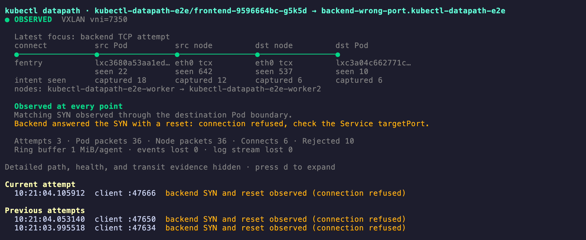

# kubectl-datapath

`kubectl-datapath` shows **where Kubernetes traffic was observed and where
matching evidence stopped**. It is an educational tool for exploring how
traffic moves through application, Pod, Service, and node boundaries.


It starts short-lived, credential-free agents on the involved nodes, captures
selected kernel evidence with eBPF, and renders a live terminal view. It does
not turn missing packets into delivery or drop verdicts.

## Why use it?

Use `kubectl-datapath` when you need to answer questions such as:

- Did the application target a Service, Pod, or DNS endpoint?
- Was Service translation visible before or after the source Pod boundary?
- Did a cross-node packet appear on both node underlay interfaces?
- Which CoreDNS Pod handled the query?
- Is the latest failure near the source Pod, between nodes, or near the
  destination Pod?
- Is an old successful connection being confused with a newer failed attempt?

## How it works


Agents are privileged because they attach eBPF programs on their node, but
they receive no ServiceAccount token and are deleted when the trace ends. See
[Architecture and design](docs/architecture.md) for details.

## Requirements

- Linux Kubernetes nodes with BTF and cgroup v2. TCX is preferred on Linux
  6.6 or newer; the agent falls back to classic `clsact` TC packet hooks when
  TCX is unavailable.
- Permission to create, read logs from, and delete privileged Pods in the
  agent namespace (`kube-system` by default).
- Pod Security admission and cluster policy must allow the short-lived agents
  to use `hostNetwork`, `hostPID`, and read-only host procfs/cgroup mounts.
- Selected Pods must have a default route or exactly one non-loopback network
  interface. Multus secondary interfaces and Windows nodes are not currently
  supported.

Agents expire after 30 minutes if the client disappears. A normal trace
deletes them immediately when it exits.

## Quick start

```sh
make build
./bin/kubectl-datapath trace pod default/frontend --to backend
```

When installed as a kubectl plugin, run `kubectl datapath` instead.

The agent image defaults to `ghcr.io/srodi/kubectl-datapath:dev`. For a local
build, run `make docker-build` (tags `kubectl-datapath:e2e`), make the image
available to your nodes (for Kind, `make kind-load`), and pass
`--agent-image kubectl-datapath:e2e`.

Other options:

- `--no-tui` writes NDJSON to stdout. Redirect it to keep a recording, then
  open it with `kubectl datapath replay events.ndjson`.
- `--agent-namespace` selects the agent namespace (default `kube-system`).
- `--max-backends` limits observed ready Service backends (default 4).
- `kubectl datapath compatibility` checks only the local machine, not
  Kubernetes nodes. A trace reports agent startup or attachment failures
  directly.

### Destination syntax

| Input | Resolution |
|---|---|
| `--to backend` | Exact Pod or Service name in the source namespace; ambiguity is rejected |
| `--to pod/backend` | Pod in the source namespace |
| `--to service/backend` | Service in the source namespace |
| `--to svc/demo/api` | Service `api` in namespace `demo` |

Every trace has an explicit destination. This keeps the TUI focused on one
path question instead of mixing unrelated node traffic.

## Reading the TUI

The primary view is one strip of capture points, left to right along the
packet path: the `connect()` intent probe (Service traces), the source Pod,
the source and destination node underlay (cross-node traces only), and the
destination Pod. Under each point are its interface, hook, and two counters:
`seen` (every packet the hook saw) and `captured` (packets sent to the ring
buffer: decoded and passing the Pod address filter, not necessarily the traced
flow). `seen` shows a hook is alive even when nothing matched.


Real output from a cross-node trace on Cilium (VXLAN) with a deny-all ingress
policy on the backend.

A Service trace adds the `connect()` intent point and per-attempt evidence.
This one targets a Service with a wrong `targetPort`: the SYN reaches the
backend Pod and the Pod answers with a reset, reported as a refused connection.



Interface kinds are shown in the details (`d`): for example `netkit (L3)`
rather than `veth`. Older recordings without link metadata use the neutral
label `pod-facing interface`. Terminals narrower than about 100 columns use a
vertical strip.

| Marker | Meaning |
|---|---|
| `●` | Matching evidence was observed |
| `◇` | Hook is attached; no matching traffic has been seen yet |
| `×` | Hook is attached and traffic was judged, but no matching evidence was observed |
| `!` | Event loss makes the point incomplete |
| `○` | Capture is not ready or unavailable |

The badge summarizes the strip: `WAITING`, `OBSERVED`, `GAP FOUND`,
`INCOMPLETE`, or `COMPLETE` once the stream ends. A `×` is **not
automatically a drop verdict**. The diagnosis localizes the narrowest gap
between adjacent observation points. Relevant NetworkPolicies are displayed as
configuration context, not proof that a specific rule dropped the packet.

| Counter | Meaning |
|---|---|
| Flows / Attempts | Distinct flows (5-tuple, both directions), or TCP attempts for Service traces |
| Pod packets | Matching packet events at the Pod-facing hooks |
| Node packets | Matching events at the node underlay hooks (cross-node traces) |
| Connects | `connect()` intents from the `fentry/__sys_connect` probe |
| Rejected | Packets a hook could not decode (for example ARP), summed over hooks, so one packet seen at two hooks counts twice; not a packet drop |
| events lost | Events the kernel could not place in the full 1 MiB ring buffer |
| log stream lost | Events that left the kernel but never reached the CLI |

Either loss figure above zero means later "not observed" results cannot be
trusted.

### Navigation

| Key | Action |
|---|---|
| `j` / `k`, arrows | Scroll the complete view |
| Page Up / Page Down | Scroll by page |
| `g` / `G` | First / last line |
| `d` | Toggle marker legend, attachment health, per-hook counters, and transit evidence |
| `q` | Quit |

## What is observed

| Evidence | Source |
|---|---|
| Application destination | BTF/fentry at `__sys_connect` for the source Pod cgroup |
| Pod boundary packets | TCX, or classic TC fallback, on the selected Pod's host-side peer interface |
| Native node transit | TCX, or classic TC fallback, on the route-selected node interface |
| VXLAN transit | Outer tuple, UDP ports, VNI, and selected inner tuple |
| DNS exchange | Source boundary plus ready `kube-dns` EndpointSlice Pods |
| Configuration context | NetworkPolicies selecting the source or destination Pods |

Service traces correlate TCP Service frontends, ready backends, DNS, TCP
attempts, and translation evidence. UDP-only Services are rejected explicitly.
Pod traces retain TCP, UDP, and ICMP traffic matching the selected Pod pair.

Host peers are discovered via the Pod interface's peer index. Rtnetlink
provides the actual link kind, netkit mode, master interface, and VRF table
when applicable. L3 netkit can expose Ethernet-format headers at these TCX
hooks; L3 mode does not imply that packet capture requires veth.

### Capture diagnostics

Press `d` to see each attachment's interface name, index, kind, master/VRF,
and cumulative counters for each ingress/egress hook:

- `seen`: packets that invoked the hook;
- `parse-rejected`: packets the parser could not decode, including unsupported
  protocols, encapsulation, or malformed/truncated headers;
- `filtered`: decoded packets excluded by the address allowlist;
- `emitted`: events submitted to the ring buffer;
- `lost`: matching events that could not be reserved in the ring buffer.

These counters describe all traffic at the hook, not only the selected flow.
They are saved in NDJSON and retained by replay. Live snapshots can race with
packet processing; final counters are read after detach. Parser rejection is
not a network drop, and zero ring-buffer loss does not prove full visibility.
Old recordings show counters as unavailable, not zero.

The ready backend set is a trace-start snapshot. If EndpointSlices change
during a trace, the trace stops and asks you to restart. `--max-backends`
limits attachments; a ready backend beyond that limit is shown as unavailable,
not as missing evidence.

## Evidence rules

- A boundary observation proves visibility at that attachment point, not
  application delivery.
- Cross-node clocks are not compared; each node keeps its own monotonic order.
- TCP attempts are separated by protocol, source address, client port, and
  initial sequence.
- Newer unresolved DNS activity supersedes an older backend attempt only when
  its `connect()` intent comes from the same source cgroup. DNS qnames are not
  captured, so the UI states that limitation; older evidence remains history.
- Event loss changes missing evidence to incomplete evidence. Sequence gaps
  distinguish log-transport loss from ring-buffer loss.
- On shutdown, every attachment reports its final sequence and ring-buffer
  loss counters. Missing or incomplete final status makes the trace incomplete.
- Unsupported encapsulation is reported as unavailable or missing evidence,
  never guessed.

## Agent cleanup

- The client deletes agent Pods after their log streams finish and final
  counters are drained, even if the TUI stays open. Transient deletion failures
  are retried; a persistent failure names the Pod that may remain.
- Cleanup needs a live client with API access. The 30-minute Pod deadline stops
  capture but does not delete the Pod.
- Deleted Pod logs are gone. Use `--no-tui` and redirect output to a file to
  keep a replayable NDJSON recording.

## Current scope

Supported today:

- IPv4 and IPv6 Pod-boundary capture
- Pod-to-Pod traces and TCP Pod-to-Service traces
- kube-proxy and socket-level Service translation evidence
- TCP attempt and retransmission correlation
- UDP/TCP DNS and observed CoreDNS responders
- Native routing and VXLAN on UDP `8472` or `4789`
- Live NetworkPolicy selection context
- Replayable NDJSON
- L3 netkit/VRF Pod boundaries with native node routing

Not decoded today:

- Geneve
- IP-in-IP
- WireGuard
- IPsec

Encrypted or unsupported underlays may hide the inner transit tuple. The tool
reports that limitation rather than inventing a path.

### Known limitations

- Observations travel from the agent to the CLI through Pod logs. Log
  rotation, truncation, or throughput limits can drop events. Sequence gaps
  and final per-attachment watermarks are reported as `log stream lost` or
  missing final status, but lost events cannot be recovered.
- Agents run with `privileged`, `hostPID`, and `hostNetwork`, and tolerate all
  taints. See [Security and threat model](docs/security.md).
- Dual-stack Pods are traced by their primary `status.podIPs` address;
  selecting a secondary address is not supported.

## More documentation

- [Architecture and design](docs/architecture.md)
- [Security and threat model](docs/security.md) and the
  [reporting policy](SECURITY.md)
- [Development, testing, and releases](docs/development.md)
