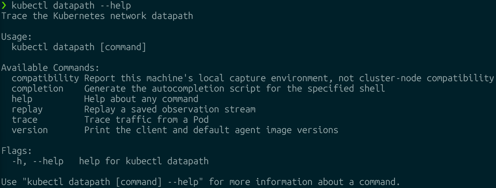
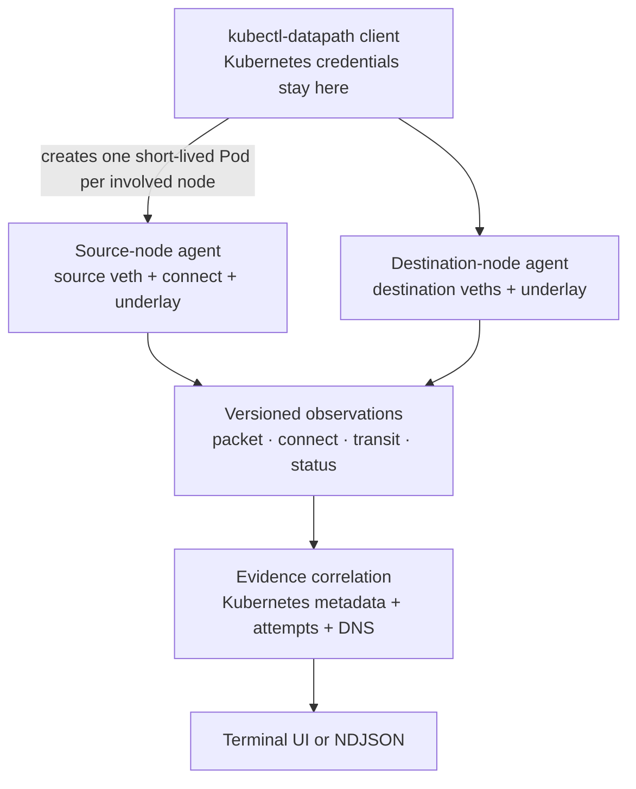

# kubectl-datapath

`kubectl-datapath` shows **where Kubernetes traffic was observed and where
matching evidence stopped**.



It starts short-lived, credential-free agents on the involved nodes, captures
selected kernel evidence, and renders a live terminal view. It does not turn
missing packets into unsupported delivery or drop verdicts.

```text
src Pod             source node          destination node       dst Pod
  ● connect intent     ● source veth         ● underlay            × host veth
                       └──── observed ────────┴──── evidence gap ────┘
```

## Why use it?

Use `kubectl-datapath` when you need to answer questions such as:

- Did the application target a Service, Pod, or DNS endpoint?
- Was Service translation visible before or after the source Pod boundary?
- Did a cross-node packet appear on both node underlay interfaces?
- Which CoreDNS Pod handled the query?
- Is the latest failure near the source Pod, between nodes, or near the
  destination Pod?
- Is an old successful connection being confused with a newer failed attempt?

## How it works



Agents are privileged because they attach eBPF programs on their node, but
they receive no ServiceAccount token and are deleted when the trace ends.

## Requirements

- Linux Kubernetes nodes with kernel 6.6 or newer, BTF, cgroup v2, and TCX.
- Permission to create, read logs from, and delete privileged Pods in the
  agent namespace (`kube-system` by default).
- Pod Security admission and cluster policy must allow the short-lived agents
  to use `hostNetwork`, `hostPID`, and read-only host procfs/cgroup mounts.
- Selected Pods must use the conventional `eth0` interface. Multus secondary
  interfaces and Windows nodes are not currently supported.

Agents expire after 30 minutes if the client disappears. A normal trace
deletes them immediately when it exits.

## Quick start

Build the current tree:

```sh
make build
```

Inspect the current machine's local capture environment:

```sh
./bin/kubectl-datapath compatibility
```

This command does **not** inspect Kubernetes nodes. A trace reports node-agent
startup or attachment failures directly.

Trace from a Pod to a Service:

```sh
./bin/kubectl-datapath trace pod default/frontend --to backend
```

Trace to a specific Pod:

```sh
./bin/kubectl-datapath trace pod default/frontend \
  --to pod/default/backend-abc
```

When installed as a kubectl plugin, use `kubectl datapath`.

### Destination syntax

| Input | Resolution |
|---|---|
| `--to backend` | Exact Pod or Service name in the source namespace; ambiguity is rejected |
| `--to pod/backend` | Pod in the source namespace |
| `--to service/backend` | Service in the source namespace |
| `--to svc/demo/api` | Service `api` in namespace `demo` |

Every trace has an explicit destination. This keeps the TUI focused on one
path question instead of mixing unrelated node traffic.

## Reading the TUI

The primary view is the selected network-namespace path:

```text
Datapath evidence
  Latest focus: backend TCP attempt
  srcNode: worker-a
    [srcPodNetNS: frontend.default]
       ● connect intent: backend.default
       └──● source veth──> [srcHostNetNS]
  transit: [srcHostNetNS] ──●── VXLAN ──●──> [dstHostNetNS]
  dstNode: worker-b
    [dstHostNetNS] ──× to destination Pod──> [dstPodNetNS: backend.default]
```

| Marker | Meaning |
|---|---|
| `●` | Matching evidence was observed |
| `×` | Capture is ready, but no matching evidence was observed |
| `!` | Event loss makes the point incomplete |
| `○` | Capture is not ready or unavailable |

An `×` is **not automatically a drop verdict**. The diagnosis localizes the
narrowest gap between adjacent observation points. Relevant NetworkPolicies
are displayed as configuration context, not proof that a specific rule dropped
the packet.

### Navigation

| Key | Action |
|---|---|
| `j` / `k`, arrows | Scroll the complete view |
| Page Up / Page Down | Scroll by page |
| `g` / `G` | First / last line |
| `d` | Toggle detailed path, attachment health, and transit evidence |
| `q` | Quit |

## What is observed

| Evidence | Source |
|---|---|
| Application destination | BTF/fentry at `__sys_connect` for the source Pod cgroup |
| Pod boundary packets | TCX on the host side of the selected Pod veth |
| Native node transit | TCX on the route-selected node interface |
| VXLAN transit | Outer tuple, UDP ports, VNI, and selected inner tuple |
| DNS exchange | Source boundary plus ready `kube-dns` EndpointSlice Pods |
| Configuration context | NetworkPolicies selecting the source or destination Pods |

Service traces correlate TCP Service frontends, ready backends, DNS, TCP
attempts, and translation evidence. UDP-only Services are rejected explicitly.
Pod traces retain TCP, UDP, and ICMP traffic matching the selected Pod pair.

The ready backend set is a trace-start snapshot. If EndpointSlices change
during a trace, the trace stops and asks you to restart rather than presenting
stale coverage. `--max-backends` limits attachments; if traffic selects a ready
backend beyond that limit, its boundary is shown as unavailable, not as missing
evidence.

## Evidence rules

- A boundary observation proves visibility at that attachment point, not
  application delivery.
- Cross-node clocks are not compared; each node keeps its own monotonic order.
- TCP attempts are separated by protocol, source address, client port, and
  initial sequence.
- Newer unresolved DNS activity supersedes an older backend attempt only when
  its `connect()` intent comes from the same source cgroup. DNS qnames are not
  captured, so the UI states that limitation; older evidence remains history.
- Event loss changes missing evidence to incomplete evidence.
- Unsupported encapsulation is reported as unavailable or missing evidence,
  never guessed.

## Current scope

Supported today:

- IPv4 and IPv6 Pod-boundary capture
- Pod-to-Pod traces and TCP Pod-to-Service traces
- kube-proxy and socket-level Service translation evidence
- TCP attempt and retransmission correlation
- UDP/TCP DNS and observed CoreDNS responders
- Native routing and VXLAN on UDP `8472` or `4789`
- Live NetworkPolicy selection context
- Replayable NDJSON

Not decoded today:

- Geneve
- IP-in-IP
- WireGuard
- IPsec

Encrypted or unsupported underlays may hide the inner transit tuple. The tool
reports that limitation rather than inventing a path.

For dual-stack Pods, the current trace identity and transit plan use the
primary `status.podIPs` address. IPv4 and IPv6 single-stack paths are supported;
selecting a secondary dual-stack address is not yet supported.

## Development

```sh
make generate
make check
make build
```

### End-to-end testing

The same runner is used locally and in CI. Each target creates a disposable
three-node Kind cluster, builds and loads the agent image, deploys a cross-node
frontend/backend workload, and checks allowed traffic plus ingress- and
egress-policy scenarios.

```sh
make e2e-kindnet
make e2e-flannel
make e2e-cilium
make e2e-calico
```

`make e2e-all` starts all four targets in parallel. Cilium and Calico must
enforce NetworkPolicy. Kindnet and Flannel detect enforcement from the
controlled ingress scenario, then apply the same expectation to the live
egress-policy refresh check.

CI publishes immutable images such as
`ghcr.io/srodi/kubectl-datapath:sha-<commit>`. For a private package, configure
the pull secret in the agent namespace without putting credentials in a file:

```sh
GHCR_USERNAME=... GHCR_TOKEN=... make image-pull-secret
```

Release binaries default to the matching immutable semver agent image. The
`version` command prints both values. Tag workflows publish Linux/macOS
binaries, checksums, multi-architecture agent images, and a rendered
`datapath.yaml` Krew manifest as release assets only after unit and E2E jobs
pass.

Test the complete Krew packaging and installation flow locally without
publishing:

```sh
make krew-local-install
kubectl datapath --help
make krew-local-reinstall # rebuild and replace after code changes
make krew-local-uninstall
```

The install target builds GoReleaser snapshot archives, renders a checksum-
matched manifest, installs the archive for the current OS and architecture,
and runs `kubectl datapath version`. Installation refuses to reuse an existing
plugin so stale binaries cannot pass the smoke test; use the reinstall target
after code changes.

The documentation intentionally uses GitHub-flavored Markdown and Mermaid.
Diagrams are reviewed and versioned beside the code; no generated screenshots
or documentation site are required.

For component boundaries, capture semantics, and design tradeoffs, see
[Architecture and design](docs/architecture.md).
