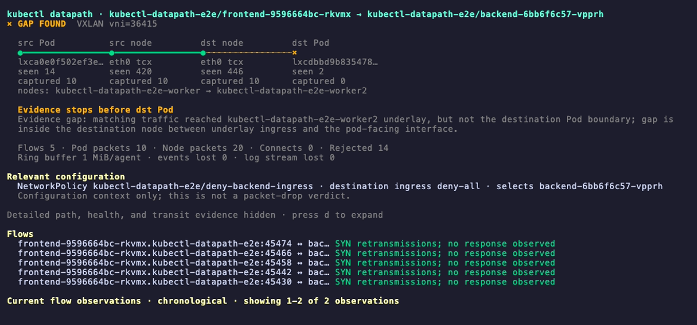

# kubectl-datapath

`kubectl-datapath` shows **where Kubernetes traffic was observed and where
matching evidence stopped**. It is an educational tool for exploring how
Kubernetes traffic moves through application, Pod, Service, and node
boundaries.


It starts short-lived, credential-free agents on the involved nodes, captures
selected kernel evidence, and renders a live terminal view. It does not turn
missing packets into unsupported delivery or drop verdicts.

```text
src Pod             source node          destination node       dst Pod
  ● connect intent     ● pod boundary        ● underlay            × pod boundary
                       └──── observed ────────┴──── evidence gap ────┘
```

## Why use it?

Use `kubectl-datapath` when you need to answer questions such as:

- Did the application target a Service, Pod, or DNS endpoint?
- Was Service translation visible before or after the source Pod boundary?
- Did a cross-node packet appear on both node underlay interfaces?
- Which CoreDNS Pod handled the query?
- Is the latest failure near the source Pod, between nodes, or near the
  destination Pod?
- Is an old successful connection being confused with a newer failed attempt?

## How it works



[Mermaid source](docs/diagrams/overview.mmd)

Agents are privileged because they attach eBPF programs on their node, but
they receive no ServiceAccount token and are deleted when the trace ends.

## Requirements

- Linux Kubernetes nodes with BTF and cgroup v2. TCX is preferred on Linux
  6.6 or newer; the agent falls back to classic `clsact` TC packet hooks when
  TCX is unavailable.
- Permission to create, read logs from, and delete privileged Pods in the
  agent namespace (`kube-system` by default).
- Pod Security admission and cluster policy must allow the short-lived agents
  to use `hostNetwork`, `hostPID`, and read-only host procfs/cgroup mounts.
- Selected Pods must have a default route or exactly one non-loopback network
  interface. Multus secondary interfaces and Windows nodes are not currently
  supported.

Agents expire after 30 minutes if the client disappears. A normal trace
deletes them immediately when it exits.

## Quick start

Build the current tree:

```sh
make build
```

Inspect the current machine's local capture environment:

```sh
./bin/kubectl-datapath compatibility
```

This command does **not** inspect Kubernetes nodes. A trace reports node-agent
startup or attachment failures directly.

Trace from a Pod to a Service:

```sh
./bin/kubectl-datapath trace pod default/frontend --to backend
```

Trace to a specific Pod:

```sh
./bin/kubectl-datapath trace pod default/frontend \
  --to pod/default/backend-abc
```

When installed as a kubectl plugin, use `kubectl datapath`.

### Destination syntax

| Input | Resolution |
|---|---|
| `--to backend` | Exact Pod or Service name in the source namespace; ambiguity is rejected |
| `--to pod/backend` | Pod in the source namespace |
| `--to service/backend` | Service in the source namespace |
| `--to svc/demo/api` | Service `api` in namespace `demo` |

Every trace has an explicit destination. This keeps the TUI focused on one
path question instead of mixing unrelated node traffic.

## Reading the TUI

The primary view is one strip of capture points, left to right along the
packet path: the `connect()` intent probe (Service traces), the source Pod,
the source and destination node underlay (cross-node traces only), and the
destination Pod. Under each point are its interface, hook, and two counters:
`seen` (every packet the hook saw) and `captured` (packets sent to the ring
buffer: decoded and passing the Pod address filter, not necessarily the traced
flow). `seen` shows a hook is alive even when nothing matched.



Real output from a cross-node trace on Cilium (VXLAN) with a deny-all ingress
policy on the backend. The Service-trace layout below uses illustrative numbers.

```text
× GAP FOUND  VXLAN vni=1
  connect          src Pod          src node         dst node         dst Pod
  ●━━━━━━━━━━━━━━━━●━━━━━━━━━━━━━━━━●━━━━━━━━━━━━━━━━●┈┈┈┈┈┈┈┈┈┈┈┈┈┈┈┈×
  fentry           veth1a tcx       eth0 tcx         eth0 tcx         veth9f tcx
                   seen 1,204       seen 98,311      seen 77,020      seen 3,911
  intent seen      captured 12      captured 12      captured 12      captured 0
  nodes: worker-a → worker-b

  Evidence stops before dst Pod
  Evidence gap: matching SYN crossed the source Pod boundary, but not the destination Pod boundary.

  Attempts 1 · Pod packets 36 · Node packets 4 · Connects 1 · Rejected 0
  Ring buffer 1 MiB/agent · events lost 0 · log stream lost 0
```

Interface kinds are shown in the details (`d`): for example `netkit (L3)`
rather than `veth`. Older recordings without link metadata use the neutral
label `pod-facing interface`. Terminals narrower than about 100 columns use a
vertical strip.

| Marker | Meaning |
|---|---|
| `●` | Matching evidence was observed |
| `◇` | Hook is attached; no matching traffic has been seen yet |
| `×` | Hook is attached and traffic was judged, but no matching evidence was observed |
| `!` | Event loss makes the point incomplete |
| `○` | Capture is not ready or unavailable |

The badge summarizes the strip: `WAITING`, `OBSERVED`, `GAP FOUND`,
`INCOMPLETE`, or `COMPLETE` once the stream ends. A `×` is **not
automatically a drop verdict**. The diagnosis localizes the narrowest gap
between adjacent observation points. Relevant NetworkPolicies are displayed as
configuration context, not proof that a specific rule dropped the packet.

| Counter | Meaning |
|---|---|
| Flows / Attempts | Distinct flows (5-tuple, both directions), or TCP attempts for Service traces |
| Pod packets | Matching packet events at the Pod-facing hooks |
| Node packets | Matching events at the node underlay hooks (cross-node traces) |
| Connects | `connect()` intents from the `fentry/__sys_connect` probe |
| Rejected | Packets a hook could not decode (for example ARP), summed over hooks, so one packet seen at two hooks counts twice; not a packet drop |
| events lost | Events the kernel could not place in the full 1 MiB ring buffer |
| log stream lost | Events that left the kernel but never reached the CLI |

Either loss figure above zero means later "not observed" results cannot be
trusted.

### Navigation

| Key | Action |
|---|---|
| `j` / `k`, arrows | Scroll the complete view |
| Page Up / Page Down | Scroll by page |
| `g` / `G` | First / last line |
| `d` | Toggle marker legend, attachment health, per-hook counters, and transit evidence |
| `q` | Quit |

## What is observed

| Evidence | Source |
|---|---|
| Application destination | BTF/fentry at `__sys_connect` for the source Pod cgroup |
| Pod boundary packets | TCX, or classic TC fallback, on the selected Pod's host-side peer interface |
| Native node transit | TCX, or classic TC fallback, on the route-selected node interface |
| VXLAN transit | Outer tuple, UDP ports, VNI, and selected inner tuple |
| DNS exchange | Source boundary plus ready `kube-dns` EndpointSlice Pods |
| Configuration context | NetworkPolicies selecting the source or destination Pods |

Service traces correlate TCP Service frontends, ready backends, DNS, TCP
attempts, and translation evidence. UDP-only Services are rejected explicitly.
Pod traces retain TCP, UDP, and ICMP traffic matching the selected Pod pair.

Host peers are discovered via the Pod interface's peer index. Rtnetlink
provides the actual link kind, netkit mode, master interface, and VRF table
when applicable. L3 netkit can expose Ethernet-format headers at these TCX
hooks; L3 mode does not imply that packet capture requires veth.

### Capture diagnostics

Press `d` to see each attachment's interface name, index, kind, master/VRF,
and cumulative counters for each ingress/egress hook:

- `seen`: packets that invoked the hook;
- `parse-rejected`: packets the parser could not decode, including unsupported
  protocols, encapsulation, or malformed/truncated headers;
- `filtered`: decoded packets excluded by the address allowlist;
- `emitted`: events submitted to the ring buffer;
- `lost`: matching events that could not be reserved in the ring buffer.

These counters describe all traffic at the hook, not only the selected flow.
They are saved in NDJSON and retained by replay. Live snapshots can race with
packet processing; final counters are read after detach. Parser rejection is
not a network drop, and zero ring-buffer loss does not prove full visibility.
Old recordings show counters as unavailable, not zero.

The ready backend set is a trace-start snapshot. If EndpointSlices change
during a trace, the trace stops and asks you to restart rather than presenting
stale coverage. `--max-backends` limits attachments; if traffic selects a ready
backend beyond that limit, its boundary is shown as unavailable, not as missing
evidence.

## Evidence rules

- A boundary observation proves visibility at that attachment point, not
  application delivery.
- Cross-node clocks are not compared; each node keeps its own monotonic order.
- TCP attempts are separated by protocol, source address, client port, and
  initial sequence.
- Newer unresolved DNS activity supersedes an older backend attempt only when
  its `connect()` intent comes from the same source cgroup. DNS qnames are not
  captured, so the UI states that limitation; older evidence remains history.
- Event loss changes missing evidence to incomplete evidence.
- Per-attachment sequence gaps distinguish log-transport loss from BPF
  ring-buffer loss.
- On shutdown, every attachment reports its final sequence and ring-buffer
  loss counters. Missing or incomplete final status makes the trace incomplete;
  a clean watermark closes the evidence window without turning a gap into a
  drop verdict.
- Agent Pods are deleted after their log streams finish and final counters
  are drained, even if the TUI remains open for inspecting results. Service
  metadata watchers stop when all capture agents finish. Transient deletion
  failures are retried; persistent failures identify the Pod that may remain.
  Cleanup still requires a live client with API access: the 30-minute Pod
  deadline stops capture but is not a deletion TTL. Deleted Pod logs are no
  longer available through `kubectl logs`; use `--no-tui` and redirect output
  to a file to retain a replayable NDJSON recording.
- Unsupported encapsulation is reported as unavailable or missing evidence,
  never guessed.

## Current scope

Supported today:

- IPv4 and IPv6 Pod-boundary capture
- Pod-to-Pod traces and TCP Pod-to-Service traces
- kube-proxy and socket-level Service translation evidence
- TCP attempt and retransmission correlation
- UDP/TCP DNS and observed CoreDNS responders
- Native routing and VXLAN on UDP `8472` or `4789`
- Live NetworkPolicy selection context
- Replayable NDJSON
- L3 netkit/VRF Pod boundaries with native node routing

Not decoded today:

- Geneve
- IP-in-IP
- WireGuard
- IPsec

Encrypted or unsupported underlays may hide the inner transit tuple. The tool
reports that limitation rather than inventing a path.

### Netkit validation

On an existing netkit-cni cluster with its Python HTTP test workloads
(`netkit-test/same-a`, `same-b`, and `cross-b`), build and load the updated
agent image on every involved node, then run:

```sh
E2E_IMAGE=kubectl-datapath:e2e make e2e-netkit
```

This checks same-node and cross-node requests, both hook directions at each
Pod boundary, native transit, detected L3 netkit and `nk-vrf` table 100,
complete final diagnostic counters, and replay metadata. It does not install
a CNI or replace workloads. Override `E2E_NETKIT_NAMESPACE`,
`E2E_NETKIT_SOURCE`, `E2E_NETKIT_SAME_NODE`, `E2E_NETKIT_CROSS_NODE`, and
`E2E_NETKIT_PORT` for equivalent workloads. `E2E_ARTIFACT_DIR` selects the
recording directory.

On Linux with BPF privileges, also run
`sudo env DATAPATH_BPF_TEST=1 go test ./internal/capture/tcx -run TestPacketDiagnosticsBPF`
to exercise parser rejection, filtering, successful emission, ring-buffer
exhaustion, and unchanged forwarding verdicts without attaching to interfaces.

For dual-stack Pods, the current trace identity and transit plan use the
primary `status.podIPs` address. IPv4 and IPv6 single-stack paths are supported;
selecting a secondary dual-stack address is not yet supported.

## Development

The generated BPF objects are checked in, so `make build` works on supported
Go development hosts, including macOS. Regenerate them through the pinned
Linux toolchain container on either macOS or Linux:

```sh
make generate
make check
make build
```

The portable generator requires Docker with support for running `linux/arm64`
images. Docker Desktop provides this on macOS; Linux hosts may need QEMU
binfmt support. The image pins the Clang 19.1.7 environment used for the
checked-in objects.

### End-to-end testing

The same runner is used locally and in CI. Each target creates a disposable
three-node Kind cluster, builds and loads the agent image, deploys a cross-node
frontend/backend workload, and checks allowed traffic plus ingress- and
egress-policy scenarios.

```sh
make e2e-kindnet
make e2e-flannel
make e2e-cilium
make e2e-calico
```

`make e2e-all` starts all four targets in parallel. Cilium and Calico must
enforce NetworkPolicy. Kindnet and Flannel detect enforcement from the
controlled ingress scenario, then apply the same expectation to the live
egress-policy refresh check.

Besides the baseline and NetworkPolicy scenarios, every target checks two
Service misconfigurations (`deploy/e2e/service-misconfig.yaml`):

- **Wrong `targetPort`:** the trace shows the connect intent, the translated
  SYN at the backend Pod boundary, and the backend's RST. Translation and
  delivery to the Pod boundary worked; the failure is above the datapath.
- **Selector matching no Pods:** the trace refuses to start because the Service
  has no ready EndpointSlice backends, and emits no evidence.

The Calico target patches the pinned manifest to IP-in-IP `CrossSubnet`
(`CALICO_IPIP_MODE`), so same-subnet Kind nodes route natively and node
transit is asserted. Calico's default `Always` IP-in-IP mode is not decoded.

CI publishes immutable images such as
`ghcr.io/srodi/kubectl-datapath:sha-<commit>`. For a private package, configure
the pull secret in the agent namespace without putting credentials in a file:

```sh
GHCR_USERNAME=... GHCR_TOKEN=... make image-pull-secret
```

Release binaries default to the matching immutable semver agent image. The
`version` command prints both values. Tag workflows publish Linux/macOS
binaries, checksums, multi-architecture agent images, and a rendered
`datapath.yaml` Krew manifest as release assets only after unit and E2E jobs
pass.

Test the complete Krew packaging and installation flow locally without
publishing:

```sh
make krew-local-install
kubectl datapath --help
make krew-local-reinstall # rebuild and replace after code changes
make krew-local-uninstall
```

The install target builds GoReleaser snapshot archives, renders a checksum-
matched manifest, installs the archive for the current OS and architecture,
and runs `kubectl datapath version`. Installation refuses to reuse an existing
plugin so stale binaries cannot pass the smoke test; use the reinstall target
after code changes.

Architecture diagrams are generated from the version-controlled Mermaid files:

```sh
make architecture-diagrams
make check-architecture-diagrams
```

Commit both the `.mmd` source and generated `.svg`. CI rejects stale SVGs.

The documentation uses GitHub-flavored Markdown and generated SVG diagrams.
Mermaid sources remain versioned beside the SVGs so diagram changes stay easy
to review without requiring a documentation site.

For component boundaries, capture semantics, and design tradeoffs, see
[Architecture and design](docs/architecture.md).

Before granting access to privileged agents, review the
[security and threat model](docs/security.md) and the
[security reporting policy](SECURITY.md).
