# Architecture and design

This document explains how `kubectl-datapath` gathers evidence, how that
evidence is interpreted, and why the project deliberately avoids stronger
claims.

## Design goals

1. **Answer one path question.** A trace always has a source Pod and an explicit
   Pod or Service destination.
2. **Teach through observable evidence.** Help users explore the Kubernetes
   datapath by making observation points, translations, and evidence gaps
   visible.
3. **Show evidence before conclusions.** Observation points and uncertainty are
   visible in the primary TUI map.
4. **Keep cluster access local.** Kubernetes credentials never enter capture
   agents.
5. **Leave no permanent privileged component.** Agents exist only for the
   trace.
6. **Scale by node, not attachment.** One agent Pod on each involved node hosts
   independent capture sessions.
7. **Keep artifacts reviewable.** Observations are versioned NDJSON; diagrams
   are generated SVGs with Mermaid sources stored beside them.

## System architecture



[Mermaid source](diagrams/system-architecture.mmd)

### Trust boundary

The client owns Kubernetes credentials, resource resolution, metadata
enrichment, correlation, and presentation.

Each agent Pod is:

- pinned to one involved node;
- privileged, host-networked, and host-PID;
- mounted read-only to host procfs and cgroup v2;
- created without a ServiceAccount token;
- bounded by a 30-minute deadline;
- deleted when the trace ends.

The privilege is broad at the node boundary, so minimizing agent lifetime and
count matters. Grouping by node reduces a typical cross-node Service trace from
six privileged Pods to two without combining evidence identities.

This credential boundary is not a confinement boundary. A privileged,
host-PID agent should be treated as having node-root-equivalent access even
though caller credentials and ServiceAccount tokens are absent. See
[Security and threat model](security.md).

## Trace lifecycle



[Mermaid source](diagrams/trace-lifecycle.mmd)

All targets are known before agents start. A node agent receives a list of
Pod-UID or route targets, opens one capture session for each, and multiplexes
their events onto one log stream.

For Pod targets, the agent indexes host process cgroup files once for all
requested Pod UIDs, then resolves each Pod's interface and cgroup IDs from that
index. This avoids a full `/proc` scan per attachment when a node hosts several
selected endpoints.

The sessions remain independent:

- separate BPF objects and maps;
- separate ring buffers;
- separate attachment IDs and sides;
- separate readiness and error attribution;
- separate event-loss counters.

This preserves the existing evidence model while reducing Kubernetes objects
and startup overhead.

## Datapath observation model

The TUI map represents network namespaces and instrumented boundaries, not an
idealized packet-delivery promise.



[Mermaid source](diagrams/datapath-observation.mmd)

### What each point proves

| Observation point | Proves | Does not prove |
|---|---|---|
| `connect()` entry | Destination supplied by the application | Successful connection or packet transmission |
| Source host-side peer | Packet crossed the selected Pod boundary | Packet passed every source-node policy or routing hook |
| Source underlay | Matching packet reached the selected node interface | Remote-node arrival |
| Destination underlay | Matching packet was visible on the destination node interface | Delivery to the destination Pod |
| Destination host-side peer | Matching packet reached that Pod boundary | Application acceptance or processing |

Capture programs attach at explicit kernel points. Other CNI programs may run
before or after them. The UI therefore says “observed” and “no matching
evidence,” not “delivered” and “dropped.”

The diagrams illustrate veth-based paths; live interface identity is not
inferred from those examples. Pod peer discovery follows `iflink`, and
rtnetlink identifies link kind, netkit L2/L3 mode, master, and VRF table.
The same TCX/classic TC strategy can observe netkit peers where the packet
path traverses those hooks. It does not attach netkit-specific BPF programs.
Packet points are named `pod-boundary/tcx` or `pod-boundary/tc`. Replay still
recognizes legacy `host-veth/*` points and their host-relative directions,
but does not infer link kind from a historical point or interface name.

Each packet hook has per-CPU counters for invocations, parser rejection,
address-filter rejection, successful ring submissions, and ring loss.
Periodic status messages carry aggregated counters without consuming packet
sequence numbers; final snapshots follow hook detachment. They distinguish
capture failure modes, not forwarding verdicts. A zero invocation count is
different from a parser/filter rejection, and missing legacy counters are
unavailable rather than zero. These additive schema-version-1 metadata fields
survive NDJSON recording and replay.

## Service and DNS translation

For a Service trace, the client correlates three address views:



[Mermaid source](diagrams/service-translation.mmd)

A changed address localizes translation relative to observation points. It does
not identify the specific kube-proxy or CNI program responsible.

DNS is a prerequisite path, not background noise:



[Mermaid source](diagrams/dns-path.mmd)

If a newer DNS query has no response, it becomes the primary focus and an older
backend TCP attempt becomes historical only when the DNS and backend connect
intents came from the same source cgroup. DNS qnames are not captured, so the
UI does not claim that the query named the selected Service. This prevents
sidecar DNS traffic from casually replacing the application path.

### Socket load balancing and policy

Socket-level Service translation and NetworkPolicy enforcement may occur at
different hooks. For example, Cilium can translate `kube-dns` to a CoreDNS Pod
at a cgroup socket hook, while enforcing egress later in the endpoint datapath.
The tracer may therefore observe:

```text
● application intended kube-dns
● source veth carries the translated CoreDNS address
× no matching packet at the source underlay
```

That localizes the evidence gap inside the source node. A selecting egress
policy is useful context, but without direct policy-verdict capture it remains
context rather than proof of the responsible rule.

## Correlation and freshness

### TCP attempts

A TCP attempt is keyed by:

- protocol;
- source Pod address;
- client port;
- initial TCP sequence.

Retransmitted SYNs remain part of the same attempt. Backend and transit SYNs
must match the initial sequence, preventing an old connection that reused a
client tuple from satisfying the latest path.

### Current versus historical evidence

For Service traces, the primary map follows the newest relevant activity:

1. newer unresolved DNS activity;
2. otherwise, the newest TCP attempt;
3. older attempts remain timestamped history.

Pod-to-Pod traces instead summarize selected-pair traffic across protocols
and directions. Their focus is `selected pod traffic`, not a TCP attempt.

Event loss changes a missing point to **incomplete**. Cross-node events retain
node-local monotonic order; clocks from different nodes are never used to
calculate latency.

Each BPF session emits a monotonic sequence and cumulative ring-buffer loss.
The client validates sequence continuity per attachment. A gap not explained
by ring-buffer loss is reported separately as log-transport loss.

During shutdown, the agent detaches capture hooks, reads the final sequence and
loss counters, then emits a terminal status for every attachment. The client
stops agents on interruption while keeping the NDJSON delivery pipeline alive
to drain their final counters before returning. The client
checks that all expected attachments supplied a complete terminal status before
accepting a natural end of the log stream. Missing or incomplete status is
reported as incomplete evidence, including loss at the end of a trace where no
later packet could expose a sequence gap. Agent cleanup and Pod deletion errors
are returned to the caller rather than silently discarded.

## Capture implementation

| Capture | Attachment | Filter |
|---|---|---|
| Pod packets | TCX, or classic TC fallback, on host-side veth ingress and egress | Selected Pod interface; client trace correlation |
| Application intent | BTF/fentry on `__sys_connect` | Selected source Pod cgroup IDs |
| Native transit | TCX, or classic TC fallback, on route-selected interface | Both selected inner addresses |
| VXLAN transit | TCX, or classic TC fallback, with UDP `8472` / `4789` decoding | Both selected inner addresses |

The agent resolves Pod interfaces from the Pod UID and host cgroup/procfs
state. Selected source, destination, Service, backend, and DNS addresses are
loaded into a BPF map so unrelated traffic on busy Pod and CoreDNS veths is
discarded before ring-buffer emission. Underlay interfaces come from a route
lookup to the remote Node InternalIP; no default node-interface name is
assumed.

TCX is the preferred packet attachment because its link lifecycle is
kernel-owned. If TCX attachment reports that the hook is unsupported, the
agent installs uniquely identified direct-action filters on a shared `clsact`
qdisc and removes only those filters at cleanup. It never removes the shared
qdisc, which may also contain CNI-managed filters. Connect intent still uses
BTF/fentry in both modes.

Pod interface discovery follows the Pod network namespace's IPv4 or IPv6
default route. If neither route exists, the agent accepts exactly one
non-loopback interface. Secondary Multus interfaces remain an explicit current
limitation.

Current inner-tuple decoding supports native IPv4/IPv6 and VXLAN. Geneve,
IP-in-IP, WireGuard, and IPsec are not decoded.

## Important design choices

| Choice | Why | Tradeoff |
|---|---|---|
| One `trace pod ... --to ...` workflow | Keeps the mental model goal-oriented | Requires an explicit destination |
| One ephemeral agent Pod per involved node | Reduces privileged Pods, scheduling, logs, and cleanup | One agent failure removes all capture points on that node |
| Independent BPF session per attachment | Preserves isolation, attribution, and current map semantics | More BPF objects and ring buffers inside each agent |
| No persistent DaemonSet | No always-on privileged component or installation lifecycle | Higher startup latency for each trace |
| Credentials only in the client | Smaller credential and trust surface | Metadata enrichment depends on the client remaining connected |
| Evidence, not delivery verdicts | Avoids false certainty across CNIs and kernel hooks | Users must interpret gaps rather than receive simplistic pass/fail output |
| Route-selected interfaces | Works without assuming `eth0` or a specific CNI | Unsupported or encrypted underlays can hide inner traffic |
| Separate node-local chronology | Avoids invalid cross-node clock comparisons | No cross-node latency calculation |
| Versioned NDJSON | Replayable, testable, automation-friendly evidence | Schema changes require compatibility discipline |
| Stop when Service backends change | Prevents stale attachments from being shown as current | Long-running traces must restart after rollouts or readiness changes |
| Bounded backend instrumentation | Controls privileged attachment and BPF cost | Uninstrumented selected backends are shown as unavailable |
| Mermaid in Markdown | Responsive, reviewable, and easy to update with code | Rendering depends on Mermaid support in the viewer |

### Why not share one BPF object per node?

Boundary and transit sessions currently require different per-object capture
modes and selected-address maps. Keeping separate objects avoids cross-target
state coupling and makes errors and loss attributable. Sharing programs or maps
may reduce node-agent memory later, but only if the event model continues to
identify the exact attachment.

### Why not deploy a DaemonSet?

A DaemonSet would reduce trace startup time, but it would leave a privileged
observer running on every node and introduce installation, upgrade, RBAC, and
multi-user isolation concerns. The current design favors on-demand debugging
with explicit lifetime.

## Compatibility and extension points

Unsupported capture paths must return compatibility evidence rather than
silently changing semantics.

The `capture.Strategy` interface allows future implementations, such as
cgroup-v2 packet hooks, classic tc, Cilium netkit, or CNI-specific verdict
adapters, without changing the observation schema or TUI model.

When adding a new observation point:

1. define exactly what it proves and does not prove;
2. preserve attachment identity and loss accounting;
3. add correlation tests for stale and unrelated traffic;
4. update the Mermaid diagrams in this document;
5. add replay data when the event shape or semantics change.
